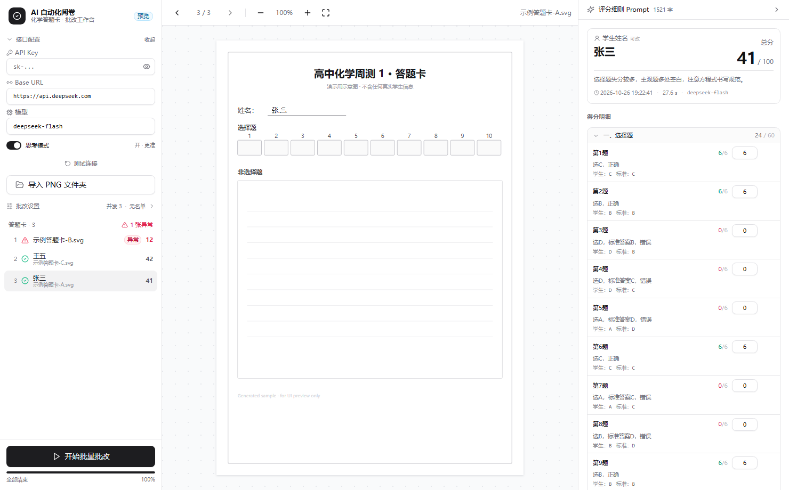
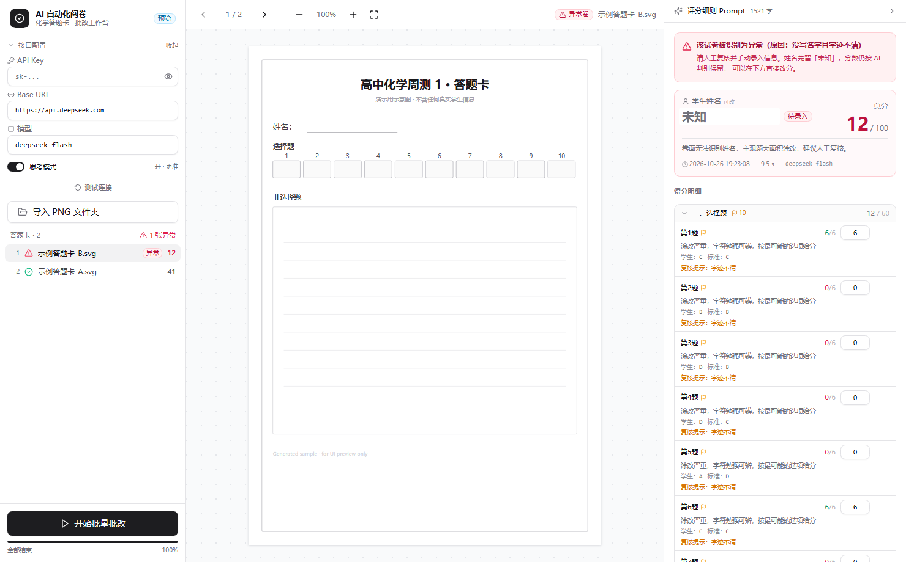

# 通用 AI 自动化阅卷系统

导入答题卡文件夹 → 调视觉模型逐张批改 → 实时看给分理由 → 人工改分覆盖 → 异常卷（没写名字 / 字迹不清）自动拦截置顶。

接口不锁死一家：**OpenAI 兼容**（DeepSeek / OpenAI / 百炼兼容模式 / 硅基流动 / vLLM…）与 **Anthropic 兼容**（Claude）两套协议都支持，左栏「服务商」下拉一选就连协议、地址、模型、思考参数一起配对。

批改完成后列表按总分重排、显示名换成考生姓名（文件名不动）。可提前导入班级名单，让模型只能从名单里挑名字，避免手写姓名被读成别的字。

Tauri v2 (Rust) + React 18 + TypeScript + TailwindCSS + shadcn/ui。

| 正常卷 | 异常卷（红色横幅 + 列表置顶 + 姓名「未知」） |
|---|---|
|  |  |

> 截图取自 `npm run dev` 的预览模式，用的是**虚构示例数据**（姓名「张三」、代码画的示意答题卡 SVG），不含任何真实学生信息。

---

## 项目结构

```
ai-grading-system/
├── index.html
├── package.json
├── vite.config.ts                  # 端口 1420，@ → ./src
├── tailwind.config.js              # shadcn 的 HSL 变量方案
├── postcss.config.js
├── tsconfig.json
├── components.json                 # shadcn/ui 约定（可继续 npx shadcn add）
├── rubric.md                       # ★ 内置评分细则，前后端共用这一份
├── public/sample/                  # 预览用的示意答题卡（SVG，虚构）
│   ├── card-a.svg
│   └── card-b.svg
│
├── src/                            # ── 前端 ──
│   ├── main.tsx
│   ├── App.tsx                     # 三栏骨架 + 事件订阅生命周期
│   ├── index.css                   # 主题变量、画布底纹、细滚动条
│   ├── types.ts                    # 与 models.rs 一一对应（手写对齐）
│   ├── store.ts                    # zustand：状态 / 改分 / 修改日志 / 导出
│   ├── lib/
│   │   ├── bridge.ts               # invoke + 事件 + 浏览器 mock
│   │   ├── order.ts                # 异常置顶 + 按分数降序
│   │   ├── providers.ts            # 服务商预设：协议 / 地址 / 模型 / 思考参数四件套
│   │   ├── roster.ts               # 名单文本 ↔ 数组
│   │   ├── score.ts                # 总分重算、分数着色、分组
│   │   ├── rubric.ts               # ?raw 引入 rubric.md
│   │   └── utils.ts                # cn()
│   ├── components/
│   │   ├── Sidebar.tsx             # 左栏：配置 / 导入 / 文件列表
│   │   ├── ImageViewer.tsx         # 中栏：缩放 / 拖拽 / 翻页
│   │   ├── GradePanel.tsx          # 右栏：横幅 / 学生卡 / 明细 / 导出
│   │   ├── ScoreList.tsx           # 按题型折叠 + 逐题改分
│   │   ├── RevisionLog.tsx         # 修改日志时间轴
│   │   ├── PromptEditor.tsx        # 评分细则折叠编辑器
│   │   ├── PdfNotice.tsx           # 首次导入 PDF 时的规则弹窗（一 PDF 一考生 / dpi / 加密不支持）
│   │   ├── Toaster.tsx
│   │   └── ui/                     # shadcn 基础件（button/input/…）
│   └── fixtures/
│       ├── sample.ts               # 预览数据（虚构）
│       └── sample-graded.json      # 脱敏后的评分结构样例
│
└── src-tauri/                      # ── 后端 ──
    ├── Cargo.toml
    ├── build.rs
    ├── tauri.conf.json             # asset 协议、CSP、窗口
    ├── capabilities/default.json
    ├── dev-settings.json           # 本地测试配置（gitignore，仅 debug 读取）
    ├── icons/
    └── src/
        ├── main.rs
        ├── lib.rs                  # 10 个 command 的注册与实现
        ├── models.rs               # 前后端契约
        ├── prompt.rs               # include_str!(rubric.md) + 固定 JSON 契约
        ├── scanner.rs              # 文件夹遍历（图片 + PDF）+ 自然排序
        ├── pdf.rs                  # PDF → JPEG（hayro，按长边渲染，带磁盘缓存）
        ├── imaging.rs              # 上传前瘦身：灰度 / 长边 / q82 / 原图直传
        ├── roster.rs               # 名单解析（UTF-8 / GB18030 / CSV 表头）
        ├── api.rs                  # OpenAI / Anthropic 双协议请求
        ├── parser.rs               # JSON 抠取 + 归一化 + clamp
        ├── grading.rs              # 并发编排 + 事件推送
        ├── settings.rs             # 配置持久化
        └── exporter.rs             # CSV（带 BOM）/ JSON 导出
```

## 依赖

### 前端

| 包 | 用途 |
|---|---|
| `react` / `react-dom` 18 | UI |
| `@tauri-apps/api` 2 | `invoke` / `listen` / `convertFileSrc` |
| `@tauri-apps/plugin-dialog` 2 | 系统文件夹选择器 |
| `tailwindcss` 3 + `tailwindcss-animate` | 样式 |
| `@radix-ui/react-collapsible`, `react-slot` | 折叠面板、`asChild` |
| `class-variance-authority` `clsx` `tailwind-merge` | shadcn 的样式组合三件套 |
| `lucide-react` | 图标 |
| `zustand` 5 | 状态管理（改分 / 日志在 store 里统一落地） |

### 后端

| crate | 用途 |
|---|---|
| `tauri` 2（`protocol-asset`） | 应用框架 + `asset://` 协议 |
| `tauri-plugin-dialog` 2 | 文件夹对话框 |
| `reqwest` 0.12（`rustls-tls`） | 调接口（用 rustls，Windows 不依赖 OpenSSL） |
| `tokio` 1 | 异步 runtime、`JoinSet`、`Semaphore` |
| `serde` / `serde_json` | 序列化 + 宽容解析 |
| `base64` 0.22 | 图片转 data URL |
| `walkdir` 2 | 递归遍历 |
| `chrono` | 时间戳 |
| `encoding_rs` | 名单文件可能是 Excel 另存的 GB18030 CSV |
| `hayro` 0.8 | PDF 光栅化（**纯 Rust**，不需要 pdfium.dll / MuPDF；内置标准字体与 JBIG2/CCITT 解码） |
| `image` 0.25（`png`/`jpeg`/`webp`/`bmp`） | 上传前的解码、缩放与 JPEG 编码；PDF 页缓存也走它 |
| `anyhow` / `thiserror` | 错误处理 |

## 支持的输入

**答题卡**（导入时选文件夹，递归扫描子目录）：

| 格式 | 说明 |
|---|---|
| `.png` / `.jpg` / `.jpeg` / `.webp` / `.bmp` | 一张图片 = 一位考生 |
| `.pdf` | **一份 PDF = 一位考生**，PDF 内所有页属于同一份卷子，一起提交 |

PDF 面向**纯图片 PDF**（扫描件，页面里就一张位图、没有文本层），不做文本提取也不依赖文本层：

| 页面里的图像编码 | 支持 | 典型来源 |
|---|---|---|
| `DCTDecode`（JPEG） | ✅ | 多数扫描仪 / 微信、夸克导出 |
| `CCITTFaxDecode`（G3/G4 传真） | ✅ | 黑白扫描件，体积最小的那类 |
| `JBIG2Decode` | ✅ | 部分黑白扫描仪、Adobe 优化过的 PDF |
| `JPXDecode`（JPEG 2000） | ✅ | 少数高端扫描仪 |
| `FlateDecode`（无压缩/PNG 式） | ✅ | 截图转出来的 PDF |

PDF 的约定（首次导入时会弹窗讲一遍）：

- 每页按**上传画质档位**渲染（默认长边 2048），结果以 **JPEG q82** 缓存在
  `app_cache_dir/pdf-cache/<hash>-<长边>-<g|c>/`，同一份卷子不会重复渲染；
- 单份超过 **40 页** 视为误导入（多半是把全班扫描件合成了一个 PDF），直接报错而不是硬跑；
- 加密 PDF 不支持（hayro 的已知限制），会明确提示「请另存为不加密的 PDF」；
- 文件名不做任何修改，列表里额外标一行 `PDF · N 页`。

**上传画质**（「批改设置」里，图片和 PDF 共用一套）：

| 档位 | 长边 | 适合 |
|---|---|---|
| 清晰（默认） | 2048 | 把 OpenAI high 档的 2048 打满；Claude 会自己再缩一档 |
| 标准 | 1568 | 正好是 Claude 4.6 的上限，体积再小约 40% |
| 省流 | 1200 | 网络很差时用，小字略糊 |

另有「黑白处理」（默认开，答题卡转灰度只留单通道）和「原图直传」（不缩放/不转灰度/不重编码，
只对图片生效）。三者都在 `src-tauri/src/imaging.rs` 一处收口。

**考生名单**：`.txt` / `.csv`，UTF-8（含 BOM）与 GB18030 都能读，一行一个名字。

## 开发

```bash
npm install
npm run dev          # 只跑前端（浏览器预览模式，数据是模拟的）
npm run tauri:dev    # 完整桌面应用（需要 Rust 工具链）
npm run tauri:build  # 打包
```

Rust 环境：装 [rustup](https://rustup.rs)，Windows 还需 MSVC Build Tools + WebView2（Win10/11 自带）。

本机已验证可用：`rustc 1.98.1 (x86_64-pc-windows-msvc)` + VS 2022 生成工具，`cargo` 在 `~/.cargo/bin`（已加入用户 PATH）。

> 首次 `cargo build` 要拉 400+ 个 crate（本机耗时约 12 分钟，主要是 crates.io 索引）；之后增量编译 3-6 秒。

配置优先级：`app_config_dir/settings.json`（界面里填的）> `src-tauri/dev-settings.json`（开发用，已 gitignore，仅 debug 构建读取，不会进二进制）。

## 关键实现说明

**1. 图片走 asset 协议，不走 Base64**

`convertFileSrc(path)` 生成 `asset://localhost/...`，前端只传路径。但**必须**在 Rust 端运行时授权目录：

```rust
app.asset_protocol_scope().allow_directory(&dir, true)?;
```

`tauri.conf.json` 里 `assetProtocol.scope` 故意留空数组 —— 只有老师真正选中的目录会被放行，比写 `["**"]` 安全得多。漏掉这行会稳定 403。

**2. 思考模式：用官方字段，而且默认开着**

最初按常见做法发了 `enable_thinking: false`，实测**无效**——DeepSeek 官方 API 会静默忽略这个字段（那是百炼系的），思考照跑不误（一张卷子 3526 个 reasoning token）。查文档后换成官方字段：

```json
{ "thinking": { "type": "enabled" | "disabled" } }
```

`reasoning_effort: low|high|max` 控制强度（默认 high，`none` 也可关）。思考模式下 `temperature` / `top_p` 不生效，所以只在关掉思考时才设 `temperature: 0`。

**默认开启思考**，因为实测关掉会明显变马虎（同一张样卷）：

| 模式 | 耗时 | 输出 tokens | 结果 |
|---|---|---|---|
| 开 | 28.6 s | 5744（其中思考 3526） | 得分点齐全，第 9 题「B 对 B」判对 |
| 关 | 7.1 s | 1978 | 第 9 题判 0 分，11(1) 两空（3d⁵4s² / +4）误给 4 分 |

所以 `max_tokens` 必须给足（现为 16384）。原来的 4096 会把 JSON 直接截断，而截断后的半截 JSON 又会被解析器的容错逻辑吞掉，最后给出一份"看起来很合理"的错误成绩——因此 `extract_content()` 把 `finish_reason=length` 当成硬错误抛出。

思考参数按服务商分三种写法（`api::effective_style`）：DeepSeek 走 `thinking`，OpenAI o 系列 / GPT-5 走 `reasoning_effort`，不认识的网关一个字段都不发 —— 猜错字段名的代价是官方接口直接 400，比少传一个优化参数严重得多。

**2.1 接口协议：OpenAI / Anthropic 双栈**

`protocol` 一次决定四件事，必须成套切换，缺一处就 400 或解析失败：

| | OpenAI 兼容 | Anthropic 兼容 |
|---|---|---|
| 请求地址 | `{base}/chat/completions` | `{base}/v1/messages`（`{base}` 已带 `/v1` 则不重复拼） |
| 鉴权 | `Authorization: Bearer` | `x-api-key` + `anthropic-version: 2023-06-01`（同时带 Bearer 兼容三方网关） |
| system 提示 | `messages[0].role = "system"` | **顶层 `system` 字段** |
| 图片 | `{type:"image_url", image_url:{url:"data:...;base64,..."}}` | `{type:"image", source:{type:"base64", media_type, data}}`，**不能带 data URL 前缀** |
| 思考 | `thinking` / `reasoning_effort` | `thinking:{type:"enabled",budget_tokens:4096}`（预算必须小于 `max_tokens`） |
| 结构化输出 | `response_format=json_object`（不支持时自动降级重试一次） | 没有这个字段，全靠 prompt 里的 JSON 契约 |
| 截断判定 | `finish_reason == "length"` | `stop_reason == "max_tokens"` |

左栏的「服务商」下拉就是把这四件套打包好的预设（DeepSeek / OpenAI / Anthropic / 百炼 / 硅基流动 / 自定义），`src/lib/providers.ts` 一处维护。切协议时若当前地址不属于目标协议，会自动整套换成该协议的默认预设，避免出现「Anthropic 域名 + OpenAI 路径」这种必然失败的组合。

**3. JSON 容错三层**

- `extract_json_blob()`：跳过 ```` ```json ```` 围栏和前后废话，做**括号配平扫描**（跳过字符串字面量内的 `{}` 和转义），抠出第一个完整对象；
- 宽容 serde：`score` 可能是 `"6"` 字符串、`questions` 可能是 `null`、字段名有 alias；
- `normalize()`：**用内置分值表纠正模型**（第 1-10 题 6 分、11-3-1 是 3 分……），把分数 clamp 进 `[0, max]`，补全 `label` / `section`，缺姓名强制 `is_abnormal = true`。

**4. 人工改分不污染 AI 分**

`ai_score` 永远是模型原值，人工改分只写 `overrides[file][qid]`。所以「撤销」不需要重跑模型；修改日志是纯追加的时间轴。

**5. 评分细则只有一份**

`rubric.md` 在仓库根：Rust 用 `include_str!("../../rubric.md")`，前端用 `import ... ?raw`。改细则只改一个文件，两边不会漂移。JSON 输出契约写死在 `prompt.rs`，老师编辑细则时改不到。

**6. 名单纠错：把"猜名字"变成"选名字"**

手写姓名靠视觉识别不可靠（实测会把形近的三字名读成别的字，甚至凭空造一个）。导入班级名单后，`prompt.rs` 会插入一段强约束：

- `student_name` 必须是名单里的某一个完整姓名，原样照抄；
- 形近时选字形最接近的那个，并在总评里标「姓名按名单匹配，请核对」；
- 姓名栏为空或完全对不上任何一项 → `未知` + `is_abnormal: true`；
- **不许因为名单里有某个名字就硬套**（这条单独写，否则模型会倾向于"必须选一个"）。

名单文件支持 txt / csv，UTF-8 和 GB18030 都能读（Excel 在中文 Windows 下导出的 csv 就是 GB18030，用 UTF-8 解会全变乱码，而乱码的名单比没有名单更危险）。解析会跳过表头（`序号,姓名`）和序号列。

**7. 排序：异常优先于分数**

列表排序不是单纯按分数降序，而是：

1. **异常卷永远置顶** —— 它们的分数只来自"能看清的部分"，混进排名里会让老师误判班级情况；
2. 其余已批改的按 **AI 原始总分**降序（用 `total_ai` 而不是改分后的分数，这样老师改分时列表不会突然重排、把正在看的那张顶走）；
3. 未批改 / 失败的垫底，按文件名自然序。

显示名取考生姓名，拿不到才退回文件名；**文件名本身从不修改**，第二行小字仍然显示原文件名，方便对回原始文件。

**8. PDF：一份 = 一位考生，按长边渲染进缓存**

选的是 **hayro**（纯 Rust 光栅化器），不是 pdfium/MuPDF：后者要么得随包分发 `pdfium.dll`，要么是 AGPL 许可。这和当初选 `rustls-tls` 是同一个理由 —— `cargo build` 一把过，不给用户塞二进制。

链路上有三处刻意的设计：

1. **扫描阶段只数页数**（`pdf::page_count`），不渲染。40 份 PDF 一起渲染会卡住一分钟，交互体验不可接受；
2. **渲染推迟到"选中预览"或"开始批改"**，结果写成 **JPEG q82** 落到 `app_cache_dir/pdf-cache/<hash>-<长边>-<g|c>/`。缓存键含文件路径、修改时间、大小、长边档位、黑白开关和格式版本——文件被覆盖、或老师换了档位，都会自动换目录，不会读到旧图；
3. **前端预览复用同一个缓存**：`render_pdf` 命令返回页图片路径，`` 照旧走 asset 协议（缓存目录也要 `allow_directory`，否则稳定 403）。预览用的档位就是上传用的档位，看到什么模型就看到什么。

渲染尺寸由**长边**而不是 dpi 决定（见下一节）。同一张 A4，300 dpi 要 2479×3508（8.69 MP，约 1.4~2.5 s），长边 2048 只要 1447×2048（2.97 MP，约 0.4 s）—— 而且后者才是模型真正看到的尺寸。

批改时把该 PDF 的所有页**按页序一次性**塞进同一个 user 消息（OpenAI 用多个 `image_url`，Anthropic 用多个 `image` 块），跨越两页的题目因此能看到上下页。hayro 自述"实验性"，所以每页渲染都套 `catch_unwind`：单页炸掉只让这份卷子失败，不会带崩整批。

还有一个容易被忽略的静默失败：遇到解不出的图像编码时，hayro 不会报错，只是那一页**画不出来**——结果模型拿到一张白纸，郑重地给出「字迹不清、0 分」。所以每页渲染时会统计非白像素，若整份 PDF 一页都没画出东西（阈值 0.001%，只抓"一个像素都没有"），直接判失败并清掉那份缓存；单页空白仍然放行（答题卡背面本当如此）。

**9. 上传瘦身：模型看不到的像素，一个都不传**

先看模型自己的上限（2026 年现行）：Claude 4.6 长边 **1568** / 1.15 MP，Opus 4.7 是 2576 / 3.75 MP；OpenAI `detail:high` 先把图缩进 2048 见方、再把短边压到 768 后切 512 的 tile。也就是说 300 dpi 的 A4（8.69 MP）传上去，Claude 只吃 1.15 MP、OpenAI 只吃 2.97 MP，其余全在服务端被丢掉——**白占上行带宽，还多一次粗暴重采样**。

`src-tauri/src/imaging.rs` 把两条链路收口到一处：解码 → （可选）白底合成 → 灰度 → Lanczos 缩到长边上限 → JPEG q82。三个例外：

- 图本来就小（≤300 KB）、尺寸也达标、又已经是灰度 → **原样发**，不做二次压缩；
- 开了「原图直传」→ 连解码都跳过，一个字节都不改；
- 传的是 PDF 页 → 跳过这一步，因为 `pdf::render_pages` 已经按同一档位渲染好了。

实测（合成 A4 答题卡：表格线 + 1500 段笔迹）：**650 KB → 191 KB（−71%）**，输出 1447×2048 灰度。对模型是无损的，因为那 650 KB 里本来就有 70% 会被服务端丢掉。

## 当前状态

| 项 | 状态 |
|---|---|
| 前端类型检查 `tsc --noEmit` | ✅ 通过 |
| 前端生产构建 `vite build` | ✅ 通过（JS 265 KB / CSS 26.1 KB） |
| 真实接口联调 | ✅ `https://api.deepseek.com` + `deepseek-flash` 跑通整卷批改 |
| 异常卷识别 | ✅ 涂白姓名后正确返回 `is_abnormal: true` / `姓名: 未知` |
| OpenAI / Anthropic 双协议 | ✅ 请求体 / 鉴权 / 响应解析 / 截断判定按协议分派，有单测覆盖 |
| PDF 导入（纯图片扫描件） | ✅ 长边 2048 尺寸 1447×2048；内嵌 JPEG 页面渲染出正确像素；缓存命中 / 整份空白 / 加密 / 损坏 / 降质兜底均有单测 |
| 上传瘦身 | ✅ 灰度 + 长边 + q82 收口在 `imaging.rs`；体积 −71%、A4 渲染 0.43 s，均有单测 |
| Rust `cargo check` | ✅ 通过（rustc 1.99.1 / x86_64-pc-windows-msvc） |
| Rust `cargo test` | ✅ **51 passed, 0 failed** |
| Rust `cargo build` | ✅ 产出 46 MB debug exe（含 hayro + 内置标准字体） |

### 实测数据（同一张样卷，2026-10-26）

| 轮次 | 模式 | 耗时 | tokens | 姓名 | 总分 |
|---|---|---|---|---|---|
| 1 | 开思考 | 28.6 s | 5744 | 识别正确 | 31 |
| 2 | 关思考 | 7.1 s | 1978 | 识别正确 | 29（多算 5-7 分） |
| 3 | 开思考 | 27.6 s | 5800+ | 识别正确 | 41 |

⚠️ **同一张卷子两次批改差了 10 分**，差异集中在有涂改的选择题（第 2 题被读成 B 或 D、第 10 题被读成 B 或 D）。手写体识别本身有随机性，这套系统不能承诺"批完就是对的"，它承诺的是**把可疑的地方标出来让人复核**。

## 已知限制

- **非确定性**：同一张卷子重复批改有波动（实测 31 / 41），必须抽检。思考模式也无法用 `temperature` 压掉这个波动（文档明确思考模式忽略该参数）。
- **姓名会读错**：实测会把形近的手写姓名读串（三字名读成另一个字）。所以姓名做成了可直接编辑的输入框，改完自动记进修改日志；若异常原因是"没写名字"，补名字后会自动摘掉异常标记。
- **模型自报总分和明细经常对不上**（36 vs 29、30 vs 26）。程序一律按明细求和，并在分数下方提示 `自报 36 ≠ 明细 29`。
- API Key 以明文存在 `app_config_dir/settings.json`；开发用的测试 Key 放在 `src-tauri/dev-settings.json`（已 gitignore，仅 debug 构建读取，不进二进制）。
- **图片会被重新编码**（除非开了「原图直传」或命中"本来就小"的直通条件）。已经压缩过的低质量 JPEG 再压一次会有轻微损失，这类卷子建议开原图直传。
- **「黑白处理」会丢掉颜色**：红笔批注、彩色修正带会变成灰阶。靠颜色判分时请关掉。
- 单张图片压完仍超过 6 MB 时（极碎的噪点画面），会自动降 q60 重编一次；再超就只能靠网关放行。
- **模型必须支持图像输入**：纯文本模型（如 `deepseek-v4-pro`）能连上但读不了卷面。Anthropic 侧没有 `response_format`，JSON 只靠 prompt 约束，偶发的 ```` ```json ```` 围栏由 `extract_json_blob()` 兜住；扩展思考预算固定 4096，且必须小于 `max_tokens`。
- **并发 1–100 可调，但 100 只是"允许"**：默认 3，超过 8 基本就等于在赌网关的 RPM/TPM 额度，常见表现是 429 或长时间挂起。左侧「批改设置」里滑块和数字输入框双向联动，界面在 ≥10 时会变黄提示；后端 `grading::MAX_CONCURRENCY` 会再 clamp 一次，防止 invoke 被直接调。
- **加密 PDF 不支持**（hayro 尚未实现解密），需先另存为不加密的 PDF；单份 PDF 上限 40 页。
- **「清晰 2048」不等于 300 dpi**：长边 2048 的 A4 等效约 175 dpi，比 300 dpi 少一半像素。手写字在这个档位实测够看，但铅笔细笔迹会明显变淡——遇到这类卷子可以调回 2048 并关掉黑白处理再试。
- **小尺寸 PDF 页面不会被脑补细节**：渲染时最多放大 4 倍（放大不产生信息），所以一页 50pt 的裁切图只会得到 200px 宽的图。
- **PDF 渲染成本**：长边 2048 的 A4 页面在 debug 构建下约 0.43 s/页（含 JPEG 编码，release 更快），一份 3 页的卷子首次打开约 1.3 s；之后命中磁盘缓存。
- **PDF 不做文本提取**：系统面向纯图片扫描件，如果拿到的是"电子版 PDF"（有文本层、矢量排版），渲染结果照样能批，但会白费一次光栅化；反过来，纯图片 PDF 里如果图像编码属于 hayro 未覆盖的冷门变体，整份会被判"渲染后几乎空白"而不是给出错误成绩。
- **PDF 页按整数提交，不裁剪**：一页里如果并排印了两张答题卡，模型会当一页看；需要拆开的话先自己切图。
- 缓存目录（`app_cache_dir/pdf-cache`）不会自动清理，长期使用会积累 JPEG；换档位或更新 PDF 后旧目录成为孤儿，需要时可手动删除。
